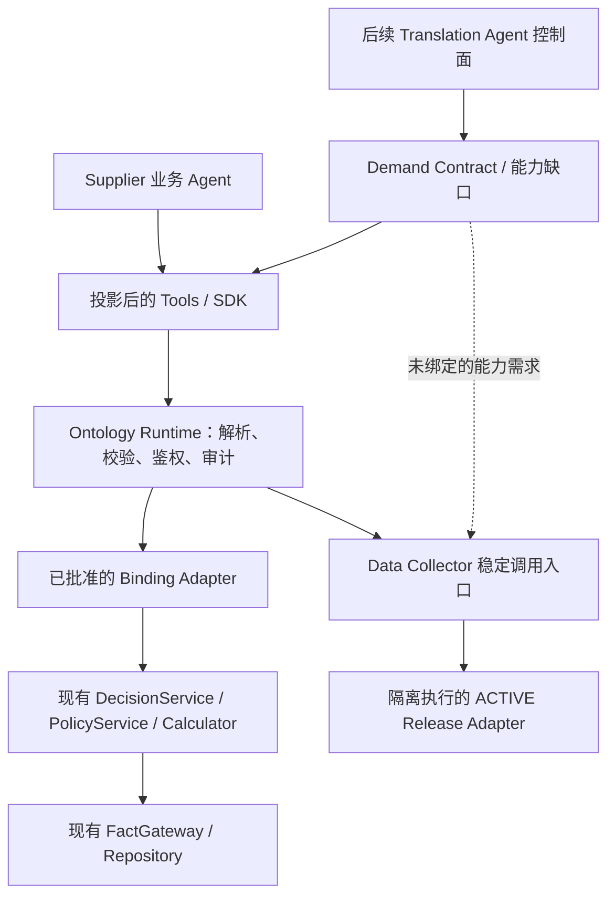

# 第 0 阶段：语义边界与所有权

**状态：迁移期间的架构约束。** 日期：2026-10-26。源码版本与[迁移清单](ontology-migration-inventory.md)一致。

## 一、总体原则

Ontology 是**跨组件的统一业务接口契约**，但不取代已有计算器、策略服务、数据存储或执行框架。它定义业务类型、关系、查询、动作、前置条件、效果、证据与实现引用。

**YAML 声明本身不能执行或保障权限。** 真正的鉴权、审核、状态检查、并发控制必须在权威执行端落实。

上述图表示**逻辑依赖**，不是要求部署独立微服务，更不表示每次业务请求都要调用 Translation Agent。

## 二、权威来源与执行责任

| 领域 | 契约由谁决定 | 执行由谁负责 | 禁止的捷径 |
| --- | --- | --- | --- |
| RFQ、Decision 跨组件类型 | 完成迁移验证后的版本化 Ontology | Supplier 领域层和 Repository | 把不完整 RFQ 视为可报价 |
| 定价策略 | Supplier 经批准的策略契约与版本 | PolicyService / DecisionService | 在 YAML 中复制第二份公式 |
| 数学计算与取整 | 原 Calculator 契约 | `calculator.py`，保留精确 Decimal 语义 | LLM 独立计算最终报价 |
| 制造与几何门控 | Supplier 规范契约 | 原有 Guard / Validation | 用人工确认绕过不可豁免门控 |
| 事实新鲜度与来源 | 业务证据要求 | FactGateway / 数据适配器 | 用文件修改时间推断业务有效性 |
| 审核和回复 | 工作流及 Action 契约 | 服务端人员权限、版本、当前状态检查 | 用 SDK 中是否有方法作为授权依据 |
| 文件发现和状态记录 | Data Collector 规范契约 | Scanner、StateStore、Orchestrator | 复制或绕过其文件状态算法 |
| 数据 Adapter 发布 | Binding 契约与现有 Manifest | 不可变 Release、Publisher、受限 Worker | 主进程直接 import AI 生成代码 |
| Agent 能力视图 | Demand Contract + 权限策略 | Projection 与运行时权限检查 | 按函数名简单裁剪当作安全机制 |
| 需求缺口处理 | 经确认的能力需求契约 | 后续 Translation / Data Agent 协作 | 将猜测的数据语义直接发布为事实 |

## 三、保留机制与策略分离

当前 Supplier Harness 已把确定性计算与政策参数分离。Ontology 只引用这些已批准策略及其语义，不再建立一套内部公式或另一个报价策略执行器。

迁移初期，**现有业务服务仍然是执行权威**。新的跨组件 Ontology 契约必须通过一致性测试后才能成为正式对外契约；出现定义与实现冲突时应阻止发布，而不是任意选择某一边继续执行。

## 四、类型分类原则

- **Object**：具有稳定业务身份、生命周期及有类型属性的对象，不只是数据库中的一张表。
- **Query**：不修改业务状态的读取能力；必要时返回来源、时效与不确定性。
- **Action**：具有明确效果、前置条件、权限、审核规则及幂等或修订语义的操作。
- **Policy Reference**：指向已批准的策略及版本，不表示可以在 YAML 中执行任意代码。
- **Binding**：经批准的 Ontology 接口到现有服务或隔离 Adapter 的映射，包含发布版本。
- **Demand Contract**：调用方需要什么能力，不代表自动获取权限，也不代表数据已经可信。
- **Projection**：根据依赖、权限和约束确定可暴露的能力；内部依赖、Guard 不应全部公开。

## 五、运行时与安全边界

第一版 Runtime 推荐实现为 Python Library，顺序为：

`Contract Version Resolve → Input Validation → Principal Authorization → Business Guard → Trusted Binding Dispatch → Output Validation → Trace/Audit`

对 Data Collector，必须通过现有稳定调用入口进入 OCI 容器沙箱；不得将生成 Adapter 导入宿主控制进程。服务端必须重新检查用户权限、数据时效和版本条件。

对于写入 Action，不应同时在同一生产环境中调用旧路径和新路径做对比；应使用隔离副本和回放。

## 六、可扩展性

**现在确定：** 命名空间、稳定 ID、版本兼容、金额与单位、证据类型、未知状态、Binding Manifest、确定性生成、严格拒绝非法引用。

**以后再做：** 分布式 Ontology Engine、可视化建模器、Schema Registry 服务、Action Graph Planner、多租户统一权限中心、图数据库、MLIR。

必须分别维护并版本化以下三种内容：
1. `Ontology Definition`：业务世界是什么，有哪些合法能力。
2. `Implementation Binding`：由哪些现有服务或数据适配器实现能力。
3. `Demand Contract`：某个 Agent 需要哪些能力及其质量要求。

这样同一份业务本体可以映射到不同供应商的 Excel、CSV、文件或 ERP 系统，而无需强迫企业重构原始数据流程。

## 七、进入 DSL v0.1 之前必须澄清

1. Quotation Draft 与 Decision 是两个对象，还是同一对象的不同投影？
2. Fact、RFQ、Review 的业务身份与版本如何确定？
3. `create`、`review`、`reply` 的实际副作用和幂等性是什么？
4. `UNKNOWN`、`AMBIGUOUS`、`UNVERIFIED`、`UNSUPPORTED`、`UNBOUND` 如何区分？
5. 跨客户、跨工作区的访问边界由哪里保障？
6. 如何将 Data Collector 的 `FunctionSpec` 和 Manifest 最小映射到 Ontology Binding？

这些待定内容不得被默认为已经允许发布的 Action。
