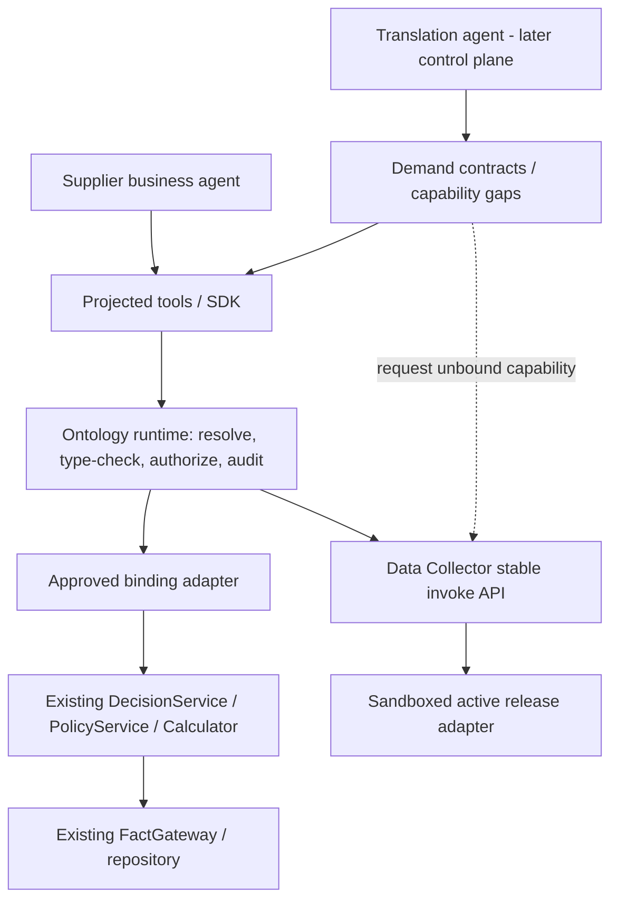

# Phase 0 — Semantic Boundaries and Ownership

Status: **migration guardrails**. Date: 2026-10-26. Based on the same pinned source revisions listed in the inventory.

## 1. Architectural rule
Ontology is the **canonical cross-component business interface contract**, not a replacement for existing computation, data stores, or workflow engines. It describes business types, links, queries/actions, required guards, effects, evidence and bindings. A claim in YAML does not enforce policy by itself: the **authoritative execution endpoint** must enforce authorization, state and review rules.

## 2. Authority and boundaries

| Area | Contract authority | Execution authority | Prohibited shortcut |
| --- | --- | --- | --- |
| RFQ / Decision public schema | versioned ontology after verified migration | supplier domain / repository | treat parsed partial RFQ as valid |
| Pricing policies | supplier policy specifications and approved versions | supplier PolicyService / DecisionService | duplicate price logic in DSL |
| Formula and numeric rounding | supplier calculator contract | `calculator.py` with Decimal | independently computed LLM quote |
| Manufacturing / geometry gates | supplier normative contracts | existing validation/gates | let human override non-overridable hard gate |
| Fact freshness / provenance | business requirements + evidence contract | source-specific FactGateway and adapters | infer business freshness from file mtime |
| Human approval & reply | workflow/action contract | trusted reviewer check, version/current-state validation | infer authorization from projected SDK visibility |
| Source discovery & manifests | data collector normative contract | collector state/orchestrator/publisher | privileged import or direct ACTIVE mutation |
| Adapter code & invocation | ontology binding descriptor and collector manifest | immutable, isolated Data Collector release/worker | execute generated code in host controller |
| Agent capability visibility | demand contract + permission policy | projection and server-side authorization | assume hidden methods are secure |
| Gap-to-adapter design | reviewed capability request | future Translation/Data Agent pipeline | publish unconfirmed inferred semantics |

## 3. Mechanism vs policy preservation
The current harness separates policies/parameters from deterministic mechanisms. Ontology **references** approved policy versions and exposes types, operations and constraints; it must not generate a second arithmetic or policy implementation. Existing business services remain the single source of truth for effective rules during migration; cross-boundary ontology definitions become normative only after conformance checks and governance approval. If drift is detected, fail closed and block publication.

## 4. Object / Query / Action classification rules
- **Object:** stable business identity + typed attributes + lifecycle, not merely a DB table.
- **Query:** no business state mutation; explicitly returns provenance, freshness and uncertainty where necessary.
- **Action:** declared business effect, prerequisites, authorization, audit and idempotency or revision semantics; side effects must be checked against real binding behavior.
- **Policy ref:** points to authoritative approved mechanism/parameter, not arbitrary executable YAML.
- **Binding:** stable typed adapter mapped to already-governed executable, with release reference and permission scope.
- **Demand contract:** consumer requirements, not evidence of authorization or source data truth.
- **Projection:** subset of **allowed public capabilities** plus hidden internal dependencies and guards; not string-name filtering.

## 5. Runtime and security posture
Phase 1 runtime should be a Python library with: contract version resolution → input validation → explicit principal/authorization → guard delegation → trusted binding dispatch → output check → trace/audit. For data collector, dispatch only via approved `data_collector.api.invoke` and the existing OCI sandbox; never import generated adapter modules into the host. The service, not the Python caller, must recheck privilege and optimistic version/current fact state.

## 6. Extension boundaries
Now: stable namespaced IDs, schema versions, backwards compatibility checks, canonical money/unit/evidence semantics, deterministic generation, binding manifest, fail-closed unknown references.
Later: registry service, schema visual editor, distributed runtime, planner/action graph, multi-tenant policy service, general graph DB, MLIR.
Keep **Ontology Definition**, **Implementation Binding**, and **Consumer Demand Contract** as separate versioned artifacts to support multiple suppliers with heterogeneous Excel/CSV/ERP without forced data migration.

## 7. Open decisions (must resolve before DSL v0.1 freeze)
1. Is a quotation draft a separate object from a Decision, or an approved projection of Decision?
2. What is the exact stable identity and version contract for a Fact, RFQ and Review?
3. Are create/review/reply operations idempotent, and what effects do they actually perform?
4. How are `UNKNOWN`, `AMBIGUOUS`, `UNVERIFIED`, `NOT_SUPPORTED`, `UNBOUND` represented distinctly?
5. Where does per-customer / per-workspace access control live?
6. What is the minimum converter from Data Collector's existing Manifest/FunctionSpec to Ontology Binding?

Do not treat any open decision as implicit permission to generate callable API endpoints.
